# VERSEVA Design

[](https://www.npmjs.com/package/@verseva/design)
[](https://github.com/verseva/design/actions/workflows/gates.yml)
[](LICENSE)

The signature design system of [VERSEVA](https://verseva.com): soft-glass material, one
energetic red accent, a fourteen-law canon, and a four-gate pipeline that enforces it.
Two CSS files, no build step. MIT.

[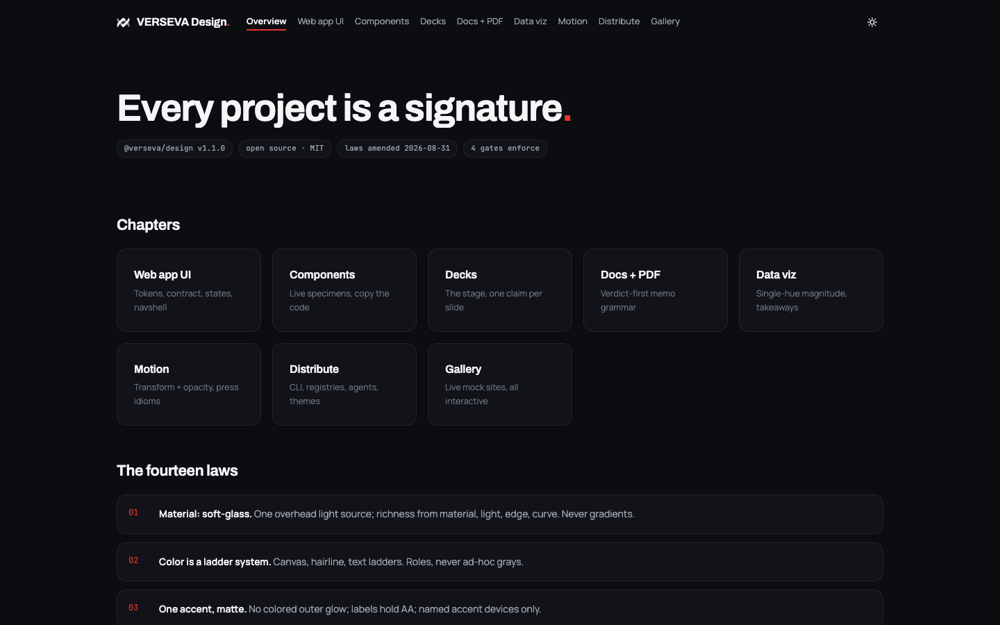](https://design.verseva.com)

Docs, live specimens, and every example below run at
**[design.verseva.com](https://design.verseva.com)**.

```sh
npm i @verseva/design
```

```html
<link rel="stylesheet" href="node_modules/@verseva/design/tokens.css">
<link rel="stylesheet" href="node_modules/@verseva/design/components.css">
```

Consumer surfaces boot light (`<html data-theme="light">`); consoles run the dark
default. `templates/starter.html` is a working single-file starting point.

## The chapters

Every chapter is preview-first: live specimens, a Show code toggle, snippets
extracted from the specimens themselves so the docs cannot drift.

<table>
  <tr>
    <td width="50%">
      <a href="https://design.verseva.com/components.html">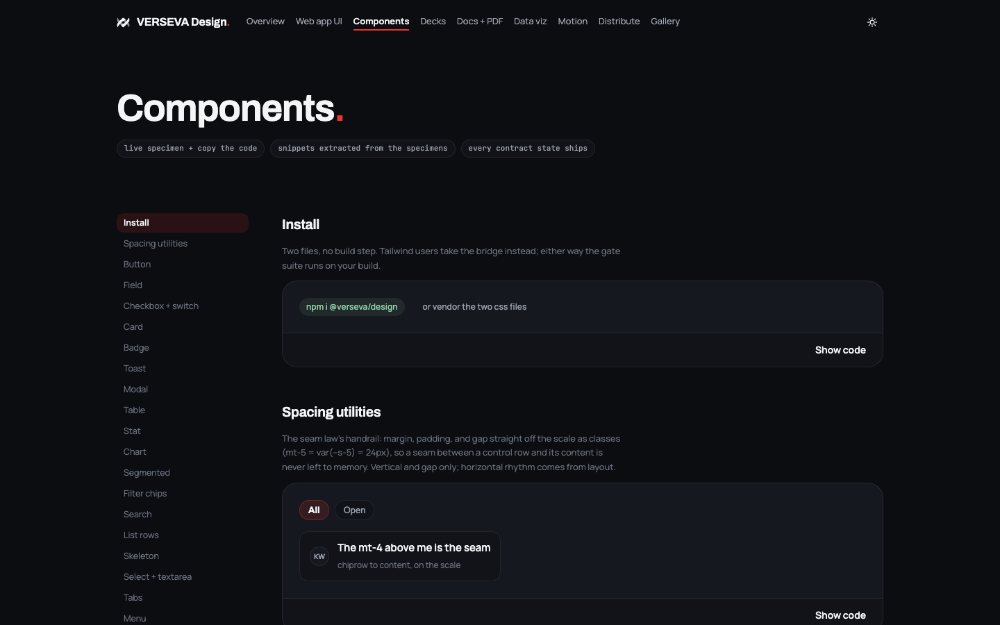</a>
      <p align="center"><b>Components</b> · the contract, every state, copy the code</p>
    </td>
    <td width="50%">
      <a href="https://design.verseva.com/data-viz">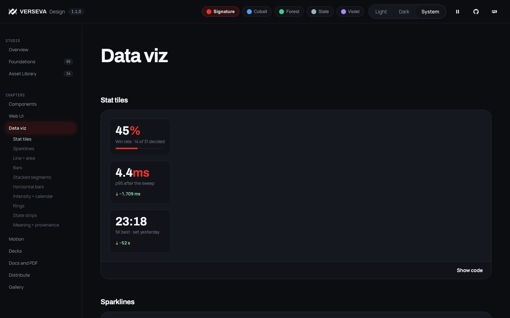</a>
      <p align="center"><b>Data viz</b> · numbers on the marks, axes are a luxury</p>
    </td>
  </tr>
  <tr>
    <td width="50%">
      <a href="https://design.verseva.com/motion.html">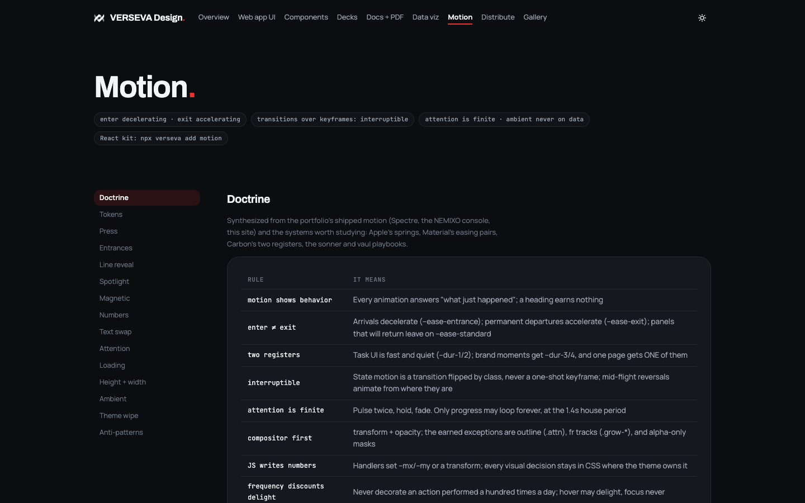</a>
      <p align="center"><b>Motion</b> · enter decelerating, exit accelerating, attention is finite</p>
    </td>
    <td width="50%">
      <a href="https://design.verseva.com/distribute.html">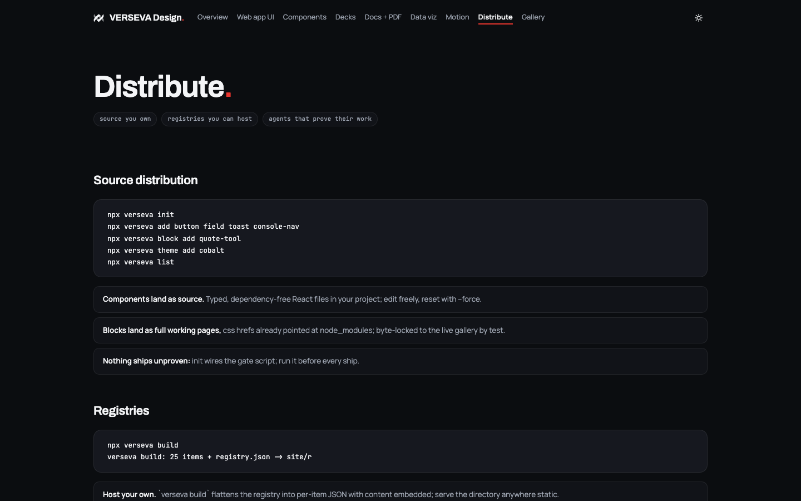</a>
      <p align="center"><b>Distribute</b> · the CLI, your registries, agents with proof</p>
    </td>
  </tr>
</table>

## The gallery

Fully coded, fully interactive example sites. Every one passes the four gates; every
one is one command away: `npx verseva block add <name>`.

<table>
  <tr>
    <td width="50%">
      <a href="https://design.verseva.com/examples/pulse.html">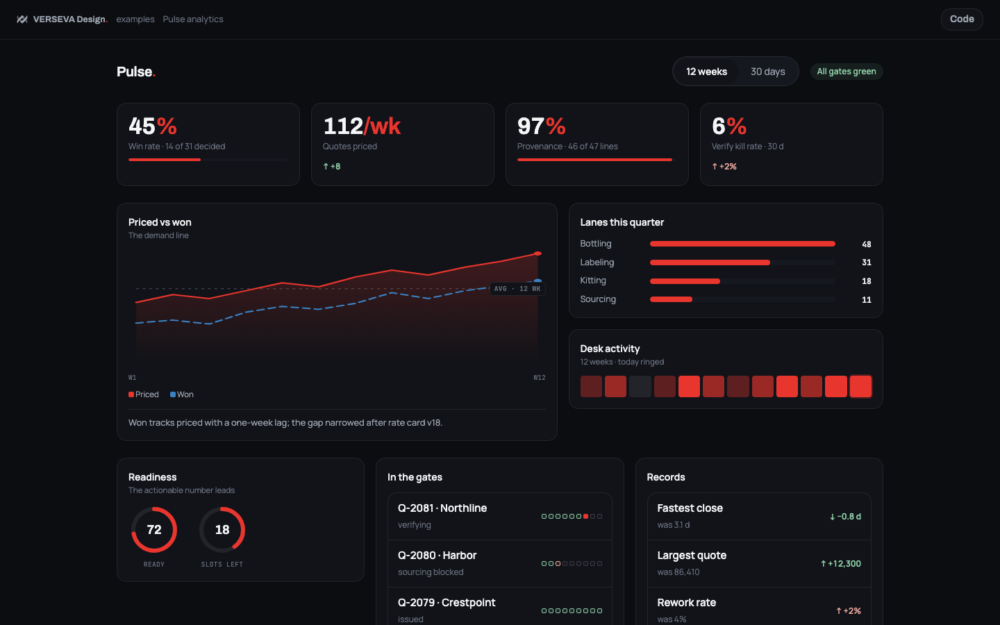</a>
      <p align="center"><b>Pulse</b> · the viz kit assembled, crosshair hover, range toggle</p>
    </td>
    <td width="50%">
      <a href="https://design.verseva.com/examples/launch.html">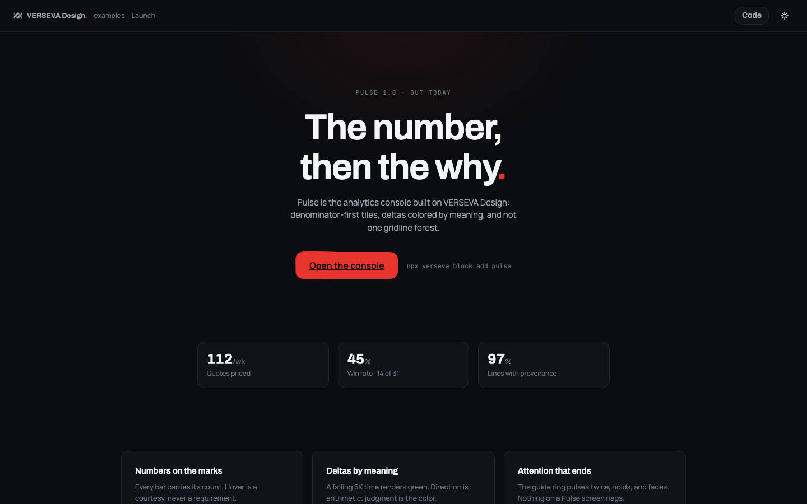</a>
      <p align="center"><b>Launch</b> · line reveal, rolling stats, magnetic CTA, theme wipe</p>
    </td>
  </tr>
  <tr>
    <td width="50%">
      <a href="https://design.verseva.com/examples/three-hero.html">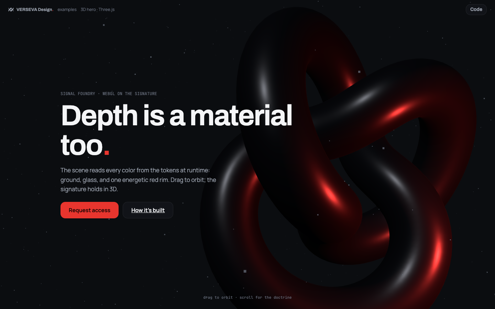</a>
      <p align="center"><b>Signal Foundry</b> · a Three.js hero reading the tokens at runtime</p>
    </td>
    <td width="50%">
      <a href="https://design.verseva.com/examples/console.html">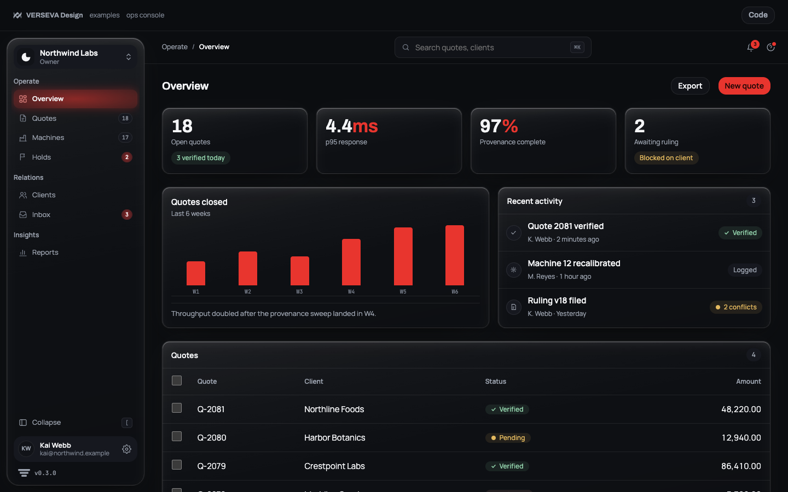</a>
      <p align="center"><b>Ops console</b> · org switcher, rail, notifications, What's new</p>
    </td>
  </tr>
  <tr>
    <td width="50%">
      <a href="https://design.verseva.com/examples/store.html">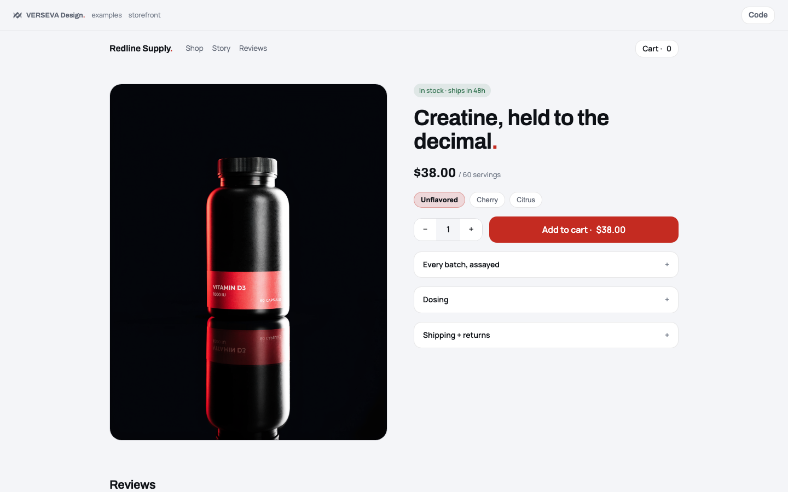</a>
      <p align="center"><b>Redline Supply</b> · the light theme, a working cart</p>
    </td>
    <td width="50%">
      <a href="https://design.verseva.com/examples.html">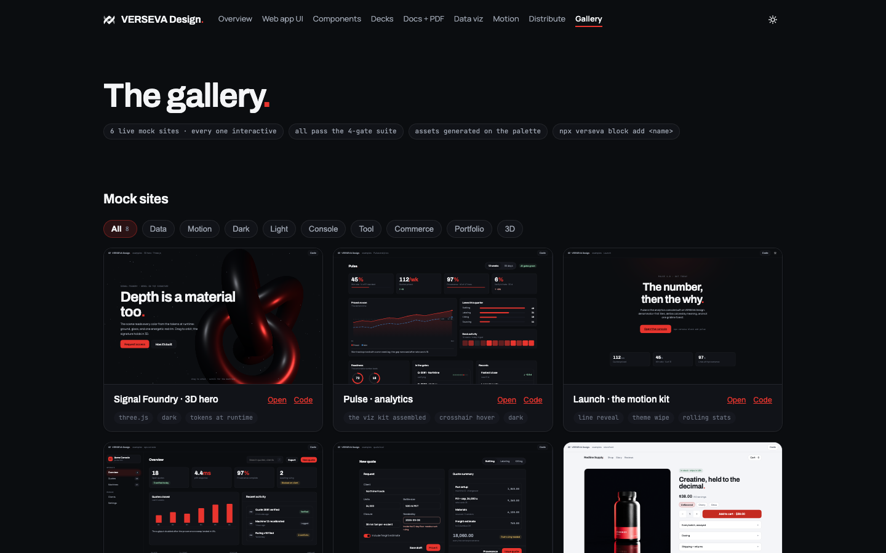</a>
      <p align="center"><b>The gallery</b> · all eight, live previews, code one click away</p>
    </td>
  </tr>
</table>

## React, source-distribution

The shadcn model, held to the signature: components land in YOUR project as typed,
dependency-free source you own, and the gate suite can prove the result stayed
on-signature, which is the part no other system does.

```sh
npx verseva init
npx verseva add button field toast console-shell console-nav org-switcher account-capsule console-topbar whats-new viz motion
npx verseva block add pulse
npx verseva list
npx verseva brief button   # source + the laws that bind it + its contract section
```

Upgrading from 1.1.0 or 1.2.0: re-add `menu` first (`npx verseva add menu --force`). `add` keeps files you already have, and the console shell parts need the 1.3.0 Menu.

`add` resolves dependencies and refuses nothing you can't edit; `block add` copies a
full working page with its css hrefs pointed at `node_modules`. The registry is
`registry.json` in this package; every listed file ships in the tarball.

Experimental: the same parts import straight from the package, `import { Sparkline } from '@verseva/design/react/viz'`. It is raw `.tsx` source, so your bundler transpiles it (in Next.js, add the package to `transpilePackages`), and prop shapes may change in a minor release until the export is declared stable.
The source is type-checked under your compiler flags: it typechecks clean under `strict` plus `noUncheckedIndexedAccess`, on `@types/react` 18 and 19.
In a server component, import default labels and limits from the pure modules (`command-state`, `console-state`, `widget-state`, `labels`), not from the client file that re-exports them.

`add` also takes `@namespace/item` (mapped in `verseva.json` under `registries`),
full URLs, and local `.json` item files, and `npx verseva build` flattens YOUR
registry into hostable per-item JSON so anyone can distribute on the same rails.
Contained by construction: written names flatten to basenames, symlink destinations
are refused, only source extensions install, fetched items must embed content, deps
stay on their item's origin, and registries are https-only.

## Doctor

```sh
npx verseva doctor            # text report
npx verseva doctor --json     # one JSON object on stdout
npx verseva doctor --strict   # exit 1 when any override exists
```

Two kinds of drift, in one report: how far the installed `@verseva/design` lags
the latest release, and every rule in YOUR CSS that targets a package class
(the contract class set from `components.css`), as file, line and selector.
The installed version comes from `package-lock.json`, else an exact pin in
`package.json`; the latest comes from one HTTPS GET to the public npm registry
(5 second timeout, no redirects, an answer over 1 MB counts as unknown). Offline
it prints `latest unknown` and still reports overrides. It reads only inside the
working directory: no symlinks are followed, `node_modules`, dot directories and
the `verseva.json` `dir` are not scanned, and a CSS file over 1 MB is skipped and
named. Exit 0 always, 1 under `--strict` with an override, 2 on error; a reader
that closes the pipe early (`| head`) does not change the code.

Limits: a malformed or symlinked `verseva.json` stops the CLI with exit 1 before
doctor runs, as it does for every command. Only `package-lock.json` is read, so a
pnpm or yarn lockfile, a range or operator pin such as `=1.4.0` with no
`package-lock.json`, and a workspace or `file:` package all report installed
unknown.

`--json` (schema 1):

```json
{
  "schema": 1,
  "package": "@verseva/design",
  "declared": "^1.5.0",
  "installed": "1.5.0",
  "installedFrom": "package-lock.json",
  "latest": "1.7.0",
  "lag": { "major": 0, "minor": 2, "patch": 0 },
  "state": "behind",
  "overrides": [
    { "file": "src/app.css", "line": 5, "selector": ".checkout .btn", "classes": ["btn"] }
  ],
  "skipped": []
}
```

`declared` is the range in `package.json` (or `null`), `installed` and
`installedFrom` are `null` when no version can be read, `latest` and `lag` are
`null` when the registry is unreachable. `state` is `behind`, `current` or
`ahead` (`null` with `lag`); a prerelease is behind its release. `lag` counts the
first numeric level that differs, the levels below it 0 (all 0 unless `behind`).
`skipped` lists CSS files not scanned, as `{ "file", "reason" }` (`over 1 MB`).
`:not()`, `:has()` and other filtering pseudo-classes do not count as targeting
a class; `:is()` and `:where()` do. `overrides` holds one row per selector (a
selector list gives one row per member), sorted by file then line; `file` is a
POSIX path relative to the working directory.

## Board

```sh
npx verseva board --manifest themes.json              # a free port
npx verseva board --manifest themes.json --port 4390
```

Every contract specimen (the Components page) under any theme a local manifest
names, on `http://127.0.0.1:<port>/`, so a theme is seen on the whole system
before it ships. Themes stay private: the manifest and the theme files live in
your project, never in this package. Pick a theme from the switcher in the
topbar; `?brand=<id>` opens one directly; an edit to a theme file shows on reload.

```json
{
  "themes": [
    { "id": "acme", "label": "Acme", "css": "brand/theme.css", "bans": ["glass"] }
  ]
}
```

`id` is the theme's `[data-brand]` slug (lowercase letters, digits, dashes);
`label` is text (1 to 64 characters); `css` resolves against the working
directory. `templates/theme-manifest.example.json` names the four presets and
runs from the package root.

Two checks sit above the specimens, for the theme and mode on screen. Contrast:
every pair in `bin/contrast-pairs.mjs`, its alpha composited over the real
backdrop (the contrast gate's math, read from the live computed tokens), with
its ratio, its floor (4.5 body, 3 large text and UI parts) and pass or fail.
Bans: `bans` (optional) names materials the theme bans, each proven on every
specimen a row in `bin/board-bans.mjs` names. A ban passes only when every row
matches at least one specimen and holds on all of them.

| Ban | Check | Specimen | Property | Expected |
|---|---|---|---|---|
| `glass` | theme adds no glass | `.card` | `backdrop-filter` | `none` |
| `glass` | glass blur nulled | `.navshell`, `.bulkbar` | `backdrop-filter` | `blur(0px)` (or `none`) |
| `bloom` | bloom nulled | `.tab.on`, `.snav a[aria-current="page"]` | `background-image` | `none` |

A ban name not in the table stops the board with one line and exit 2.

Contained by construction: the manifest and every theme must be regular files
inside the working directory (a path that leaves it, a symlink anywhere on the
path, a FIFO or a directory is refused), themes end in `.css`, and sizes are
capped (manifest 64 KB, at most 64 themes, theme 1 MB). The server binds
127.0.0.1 only, answers only a `127.0.0.1` or `localhost` Host on its port,
refuses requests a browser marks as started by another site,
serves the package's own files plus `/theme/<id>.css` by manifest id, and returns
404 for any other path however it is encoded. Every response carries
`X-Content-Type-Options: nosniff`. A bad manifest stops with one line and exit 2.

## Agents

```sh
npx verseva mcp init --client claude   # cursor | vscode
```

One zero-dependency stdio server. The agent can list the registry, read any
component's source, get one component as a brief (`get_brief`: source, only the
laws that bind it, its contract section), read the tokens and the laws, install components, and run
the full gate suite with `run_gate` to PROVE its output stayed on-signature
before calling anything done. No other design system gives an agent proof.

## Themes

Four accent presets ship gate-proven across all four theme axes (base and brand,
dark and light): `cobalt`, `forest`, `violet`, `slate`.

```sh
npx verseva theme add cobalt
```

Link it after `tokens.css`, set `<html data-brand="cobalt">`. One accent, matte
(law 3): a preset re-values the accent axis only.

## What's in the box

| Path | What |
|---|---|
| `tokens.css` | The signature: color ladders, one accent, type trio, 4px spacing scale, radius posture, elevation, motion, data-viz ladder. Dark default, one light flip block, `[data-brand]` theming |
| `components.css` | The component contract: buttons, fields, cards, tables, badges, toasts, modals, chips, stats, the viz kit, the motion kit, the navshell, plus scale-mapped spacing utilities (`mt-5`, `pb-4`, `gap-3`). Every contract state ships |
| `tailwind.css` / `preset` | The Tailwind bridge for utility-first stacks |
| `bin/` | The gate suite (below) |
| `docs/` | The laws, token reference, component contract, theming guide |
| `templates/starter.html` | Delete the copy, keep the bones |

## The gate suite

Taste here is enforced, not hoped for. Four gates, one argument set; exit 0 ships:

```sh
npx verseva-gate --tokens node_modules/@verseva/design/tokens.css src
```

| Gate | Fails on | Exception |
|---|---|---|
| `verseva-hex-gate` | Any hex not drawn from tokens | `hex-ok` + reason |
| `verseva-contrast-gate` | A token pair below 4.5:1 body / 3:1 parts, in any theme or `[data-brand]` block, alpha composited | none: craft law |
| `verseva-spacing-gate` | Inline margin/padding/gap (the seam law), multi-line JSX style objects included | `sp-ok` + reason |
| `verseva-type-gate` | Off-token faces, sizes below 9.5px, `font:` shorthand included | `type-ok` + reason |

A fifth gate, `verseva-recipe-gate`, is advisory: `verseva-gate` runs it after the four and
prints its findings under an `advisory:` heading; it never changes the exit code, even when it
errors or hangs (it is stopped after 60 seconds). `--no-advisory` skips it. It reports
buttons, tables, fields, selects and dialogs built without the contract's classes, and a
project that consumes none of the signature material (`--glass-*`, `--nav-*`,
`--accent-bloom`, or a material class). Run it alone with `--strict` to exit 1 on findings.

| Control | Effect |
|---|---|
| `recipe-ok: <reason>` | Waives one element: inside its tag or on the line above. The reason is required |
| `recipeAllow` in `verseva.json` | Path substrings the recipe gate skips |
| `material` in `verseva.json` | `"full"` (default) runs the material census; `"none"` skips it |

Wire it into your build:

```json
{
  "gate": "verseva-gate --tokens node_modules/@verseva/design/tokens.css --tokens src/theme.css src",
  "build": "npm run gate && next build"
}
```

## The laws, shortest form

1. One accent, matte. An accent that is everywhere is not an accent.
2. Mono is for machines. Everything a human reads is body type.
3. Sections must breathe. Space comes from the scale, never inline margins.
4. Hierarchy from fill, not size. Equal-sized pairs; the fill says which leads.
5. No hand-picked hexes. Every color comes from tokens; the gates decide.

The full fourteen, dated and amended in the open, live in [`docs/laws.md`](docs/laws.md).

## Theming

Brands re-value the same roles in one `[data-brand="slug"]` block; structure never
changes, and the contrast gate measures every brand block as its own theme. Recipe in
[`docs/theming.md`](docs/theming.md). Appearance (`data-theme`) and brand accent are
independent axes.

## Assets

The studio at [design.verseva.com/assets](https://design.verseva.com/assets) carries the
VERSEVA 3D library: 30 objects and 6 animated loops as GLB, each with its accent material
bound to the active theme, downloadable in any theme. Full files ship on the
[`library-2026.10` release](https://github.com/verseva/design/releases/tag/library-2026.10).
The 3D assets are licensed CC BY 4.0 ([LICENSE-ASSETS](LICENSE-ASSETS)); code stays MIT.
The VERSEVA name, wordmark and emblem are not licensed.

## Credit

Finished work built on the system may carry the line, in the display face:

**Built on VERSEVA Design.**

MIT © Verseva Services Corp
